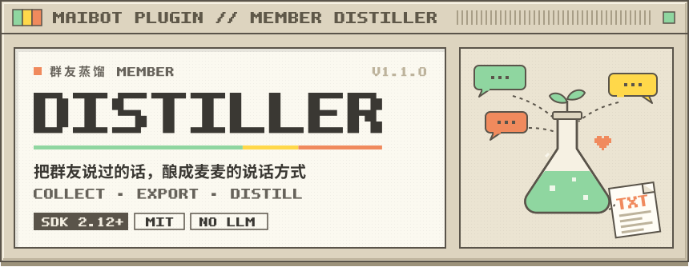
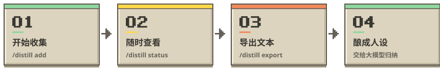

<div align="center">

  <picture><source media="(prefers-color-scheme: dark)" srcset="docs/readme/hero-night.svg"></picture>

  <p>
    
    
    
    
    
  </p>

  <p><sub>开始收集 · 随时查看 · 导出文本 · 酿成人设</sub></p>

</div>

<br>

<picture><source media="(prefers-color-scheme: dark)" srcset="docs/readme/sec-intro-night.svg"></picture>

每个群里总有那么一位群友，说话自带味道：口头禅、语气词、接梗的节奏，一眼就能认出是 TA。

**群友蒸馏**帮麦麦把这份味道慢慢收进小本本：按 QQ 号，收集 TA 之后在各个群里说的每一句文字，整理成一份干净的 TXT。你可以把它交给喜欢的大模型，归纳成麦麦的人设与表达方式草稿。

<table>
  <tr>
    <td width="33%" valign="top">
      <b>🌱 只收文字</b><br>
      <sub>只记录目标本人在群聊里的文字，不收私聊、图片、语音，也不收其他人的话。</sub>
    </td>
    <td width="33%" valign="top">
      <b>🍃 不打扰麦麦</b><br>
      <sub>插件全程不调用大模型，也不会修改麦麦现有的人设。</sub>
    </td>
    <td width="33%" valign="top">
      <b>🏡 留在本机</b><br>
      <sub>数据库与导出文件只存在机器人本机，仅文件所有者可读写。</sub>
    </td>
  </tr>
</table>

<br>

<picture><source media="(prefers-color-scheme: dark)" srcset="docs/readme/sec-flow-night.svg"></picture>

<p align="center">
  <picture><source media="(prefers-color-scheme: dark)" srcset="docs/readme/flow-night.svg"></picture>
</p>

<br>

<picture><source media="(prefers-color-scheme: dark)" srcset="docs/readme/sec-setup-night.svg"></picture>

**1. 放进插件目录**

把本仓库放到 MaiBot 的 `plugins/maibot_member_distiller`，然后在插件管理页面启用。首次安装后，需要让 MaiBot 重新扫描或重启来加载插件，加载状态以插件管理页面为准。

**2. 确认谁可以管理**

默认读取已安装的 `com.moonlycake.image-generation` 插件中的 `image.owner_qq`，这位主人可以管理收集任务；主人设置变更后会自动生效。

如果图片插件不可用或没有配置主人，默认**不授权任何人**。需要额外授权时，在 `collector.allowed_qq` 中填写，或复制 `config.example.toml` 为 `config.toml`：

```toml
[plugin]
enabled = true
config_version = "1.0.0"

[collector]
allowed_qq = []  # 额外允许管理的 QQ 号，如 ["123456789"]
```

> [!NOTE]
> QQ 号必须写成纯数字字符串。白名单为空时，只有图片插件中配置的主人可以管理。

<br>

<picture><source media="(prefers-color-scheme: dark)" srcset="docs/readme/sec-usage-night.svg"></picture>

由主人或已授权的 QQ，在机器人私聊或任意可用群聊中发送（把 `123456789` 换成目标 QQ）：

| 指令 | 作用 |
| :--- | :--- |
| 🌱 `/distill add 123456789` | 开始收集：记录 TA **此后**在所有可接收群聊中的文字 |
| 🔍 `/distill status 123456789` | 查看收集状态与已记录条数 |
| ⏸️ `/distill stop 123456789` | 停止收集，已有资料会保留 |
| 📜 `/distill export 123456789` | 导出一份 UTF-8 TXT，并回复它在机器人本机上的路径 |
| 🧹 `/distill delete 123456789` | 停止并删除数据库中该 QQ 的记录（已导出的文件需自行删除） |

<details>
<summary><b>收集范围的小细节</b></summary>
<br>

- 可以同时收集多位群友。
- 只收目标本条消息的文字；以 `/` 开头的指令消息不收集；不回溯历史消息。
- 导出内容会保留来源群、消息 ID 和时间。
- 插件重启后，收集状态和资料都会保留。
- 时间缺失或异常的消息会跳过；如果上游时间只精确到秒，刚开始收集的那一秒内可能有部分消息被跳过。

</details>

<br>

<picture><source media="(prefers-color-scheme: dark)" srcset="docs/readme/sec-persona-night.svg"></picture>

把导出的 TXT 上传给你选的大模型，再附上这段提示词：

> 请只依据这份发言样本，归纳这个人的说话风格、常用语、句式、语气和互动习惯，整理成适合麦麦的人设与表达方式配置草稿。不要把没有证据的个人背景、观点或性格当成事实；样本不足的部分请标注不确定。保留几个简短原句作为依据。

> [!TIP]
> 样本里只有 TA 一个人的话，没有上下文，所以模型对聊天场景、动机和人际关系的判断会比较有限。把草稿当作起点，再按你对 TA 的了解慢慢调整，效果会更自然。

<br>

<picture><source media="(prefers-color-scheme: dark)" srcset="docs/readme/sec-privacy-night.svg"></picture>

- 数据库和导出文件保存在麦麦分配的 `data/plugins/com.moonlycake.member-distiller/` 下，权限仅本机文件所有者可读写。
- 上传给大模型之前，请先翻一遍样本，确认里面没有不适合分享的内容。
- 收集的是一位真实群友的发言，建议先和 TA 打个招呼，得到同意再开始 🌷

<br>

<div align="center">
  <sub>为麦麦用心制作 · <a href="LICENSE">MIT License</a> © <a href="https://github.com/MoonlyCake">MoonlyCake</a></sub>
  <br>
  <sub><sub><code>docs/readme/</code> 中的插图由 <code>python docs/readme/build.py</code> 生成</sub></sub>
</div>
